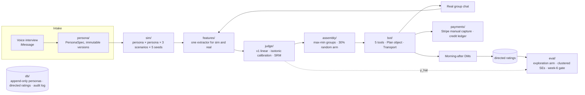

# Regulars

[](https://github.com/SatyamDave/Regulars/actions/workflows/ci.yml)
[](https://github.com/SatyamDave/Regulars/actions/workflows/docker.yml)
[](https://github.com/SatyamDave/Regulars/actions/workflows/deploy.yml)


**Simulate the conversation, then check it against what happened at dinner.**

Chemistry between two specific people cannot be predicted from what they say about themselves
(Joel, Eastwick & Finkel, 2017). So Regulars does not try to predict better; it runs thousands of
cheap simulated trials per night, one real dinner per week, and learns from the gap between them.

The specs are the source of truth:

- [`docs/product-plan.md`](docs/product-plan.md) — the problem, the insight, the product, the week-6 gate
- [`docs/technical-architecture.md`](docs/technical-architecture.md) — the buildable spec; code comments cite it by §

## Architecture



Two feature extractors, one codebase: simulated transcripts and real chat transcripts share the
same `Transcript` type and the same pipeline, so the sim can be checked against reality at the
feature level, not only at the outcome level.

### Three invariants the schema enforces

1. **Personas are append-only versions** (trigger + unique constraint). Every prediction is reproducible.
2. **Ratings are directed.** a→b and b→a are separate rows; Kenny's Social Relations Model needs both.
3. **`assembly_method` is set on every group.** ~30% of tables are assembled at random; that arm is
   the only unbiased evaluation set, and the model-vs-random retention gap is the business case.

## Repository layout

| Path | Owns | Spec |
|---|---|---|
| `regulars/core/` | Shared contracts: `Transcript`, `PersonaSpec`, `LLMClient`, feature registry | §0 |
| `regulars/db/` | SQLAlchemy Core schema, Postgres migrations, typed repositories, audit log | §1, §9 |
| `regulars/persona/` | Interview state machine, prosody, LLM extraction, versioning, legibility, encrypted chat-log import | §2, §10 |
| `regulars/features/` | Follow-ups, LSM, topic survival, disclosure, repair, question Gini; latency, reply graph, tapbacks | §4 |
| `regulars/judge/` | Transparent linear judge, isotonic calibration, SRM decomposition, variance/AUC diagnostics | §5, §6 |
| `regulars/sim/` | Scenarios, anti-sycophancy prompts, harness, cache, two-stage ranking, variance report | §3, §8 |
| `regulars/llm/` | `AnthropicLLM` (prompt caching, retries), OpenAI-compatible client for Centaur, env factory | §2, §8 |
| `regulars/assembly/` | Prefilter, max-min optimizer with continuity bonus, exploration arm, prune/backfill | §6, §7 |
| `regulars/bot/` | Five tools, `Plan` record, `Transport` seam (BlueBubbles), onboarding, lock flow, morning-after | §9 |
| `regulars/payments/` | Stripe manual-capture deposits, no-cash-payout credit ledger, webhook events | plan §6 |
| `regulars/eval/` | Person-grouped CV, cluster-bootstrap Spearman, mixed model, retention A/B, power, gate report | §6 |
| `regulars/app.py` | FastAPI: `/webhooks/stripe`, `/webhooks/bluebubbles`, `/healthz` | — |
| `tests/` | Mirrors the package layout; fully offline (`FakeLLM`, `FakeTransport`, SQLite) | — |

Cross-package imports go through `regulars.core` only. Every LLM call goes through `LLMClient`.
Every bot decision writes an audit row.

## Development

```bash
uv sync --all-extras --dev      # Python 3.12; librosa/soundfile via the `audio` extra
make check                      # ruff + mypy --strict + pytest --cov (what CI runs)
make run                        # uvicorn --reload on :8000
pre-commit install              # optional: same checks on commit
```

CLI entry points that gate the build order (§11):

```bash
uv run python -m regulars.judge.cli known-pairs features.jsonl     # step 1: does the judge rank known pairs?
uv run python -m regulars.eval.cli gate dyads.jsonl memberships.jsonl  # week 6: go / fix / stop
uv run python -m regulars.db.gen_ddl                                # Postgres DDL from the metadata
```

## CI/CD

Every push and PR runs, as separate jobs, rolled up into one required status `CI passed`:

| Job | What it guards |
|---|---|
| Lint & format | `ruff check` (incl. security rules) and `ruff format --check` |
| Typecheck | `mypy --strict` over `regulars/` |
| Tests | `pytest --cov`, coverage floor 90%, JUnit + XML uploaded |
| Migration matches schema | `gen_ddl` output diffed against `migrations/0001_initial.sql` |
| Lockfile in sync | `uv lock --check` |
| Secret scan | gitleaks over full history |

`Docker` builds a multi-stage, non-root image and pushes `ghcr.io/satyamdave/regulars` on `main`
and `v*` tags. `Deploy` runs after a green CI on `main` and deploys to Railway when the
`RAILWAY_TOKEN` secret is present (a no-op otherwise), then polls `/healthz`. Dependabot groups
weekly updates for uv, GitHub Actions, and the base image.

## Configuration

Copy `.env.example`. Nothing is required for tests. In production:

| Variable | Purpose |
|---|---|
| `DATABASE_URL` | Postgres (Supabase). Tests use in-memory SQLite. |
| `STRIPE_API_KEY`, `STRIPE_WEBHOOK_SECRET` | Manual-capture deposits and signed webhooks |
| `BLUEBUBBLES_WEBHOOK_TOKEN` | Shared token checked on `/webhooks/bluebubbles` |
| `ANTHROPIC_API_KEY` | Scoring and cheap first-pass models |
| `REGULARS_ENACTMENT_BASE_URL` | OpenAI-compatible endpoint serving Centaur for persona enactment |

## Status

Build order per §11: (1) extractor + judge ✔ (2) bot, plan object, transport, deposits ✔
(3) ratings, latency logging, prune/backfill, audit ✔ (4) sim harness + variance diagnostic ✔
(5) exploration arm ✔ (6) calibration + SRM ✔. What remains is not code: 60 texts in one zip
code, known friend pairs through the judge, and dinners.

Proprietary. See [`LICENSE`](LICENSE) and [`SECURITY.md`](SECURITY.md).
